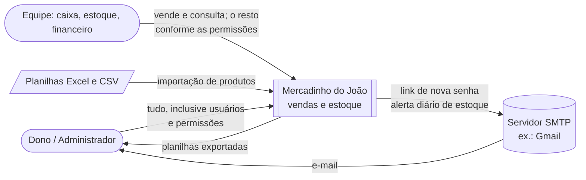
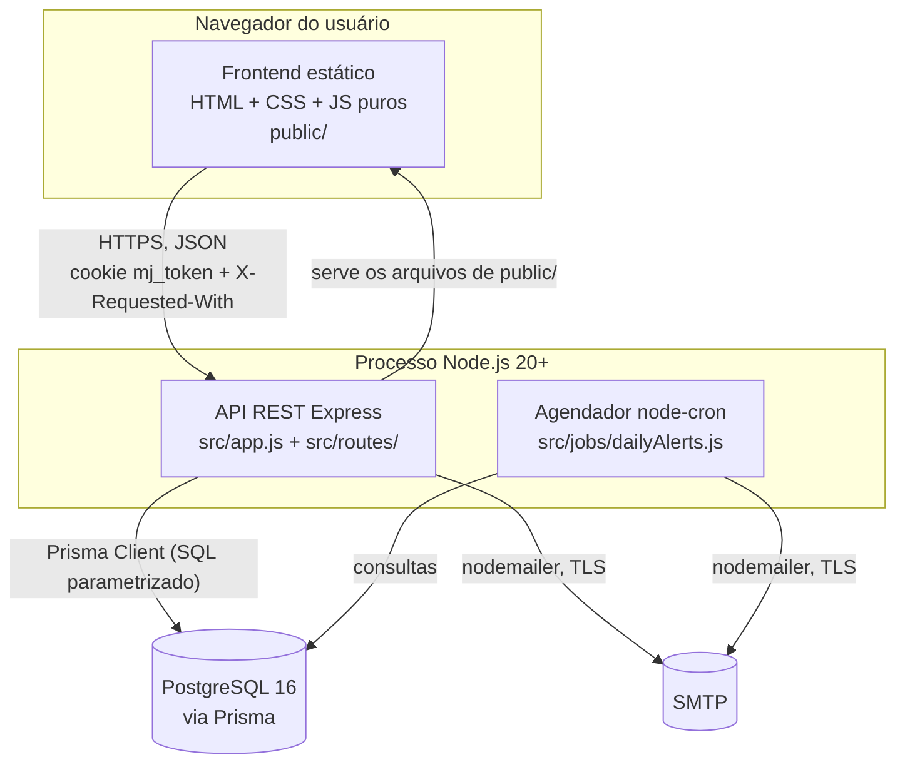
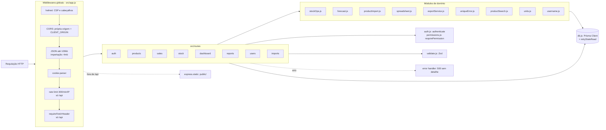
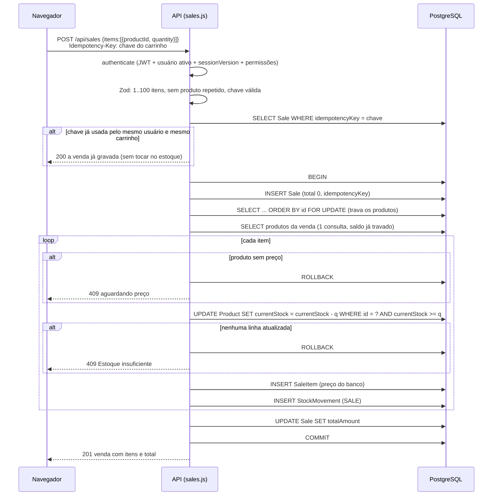

# Arquitetura

Descrição no modelo C4 (contexto, contêineres, componentes) com as seções principais do arc42 que fazem sentido para um sistema deste tamanho. O porquê de cada escolha está nos [ADRs](adr/README.md).

## 1. Objetivos e restrições

| Objetivo de qualidade | Por quê | Como |
|---|---|---|
| Estoque sempre correto | É o problema central do cliente | Baixa atômica no banco, histórico imutável, venda idempotente ([ADR-0005](adr/0005-baixa-de-estoque-atomica-no-banco.md), [ADR-0015](adr/0015-venda-idempotente.md)) |
| Seguro por padrão | Sistema na internet, com dinheiro e senhas | Permissões checadas no servidor, sessão revalidada, CSRF, CSP estrita, rate limit |
| Simples de rodar e hospedar | Cliente pequeno, um desenvolvedor | Monólito Node sem etapa de build; PostgreSQL gerenciado ([ADR-0001](adr/0001-monolito-node-express-com-frontend-estatico.md)) |
| Rápido no balcão | Fila no caixa | Busca por teclado, uma consulta por venda |

**Restrições:** um desenvolvedor; custo de hospedagem baixo; operador sem conhecimento técnico; navegador comum como cliente.

## 2. Contexto (C4 nível 1)

Não há integração com emissor fiscal, maquininha de cartão, balança ou leitor de código de barras.

## 3. Contêineres (C4 nível 2)

| Contêiner | Tecnologia | Responsabilidade |
|---|---|---|
| Frontend | HTML, CSS, JS sem framework e sem build; fonte Inter e ícones Lucide embutidos | Telas, carrinho, gráficos em SVG próprio, tema claro/escuro |
| API | Node.js, Express 4, Zod, Helmet, express-rate-limit | Autenticação, regras de negócio, validação, autorização |
| Agendador | node-cron, no mesmo processo da API | E-mail diário de alerta de estoque |
| Banco | PostgreSQL 16, Prisma 5 (ORM e migrations) | Persistência e transações |

Um único processo Node faz tudo: API, arquivos estáticos e agendador. Não há fila, cache nem serviço separado. No navegador, um service worker (`public/sw.js`) só deixa o sistema instalável e mostra a página de sem conexão; ele não guarda dados ([ADR-0018](adr/0018-app-instalavel-sem-cache-de-dados.md)).

### Implantação

| Ambiente | Como roda | Banco | Endereço |
|---|---|---|---|
| Local com Docker | `docker compose`: contêineres `app` e `db` | Contêiner `postgres:16-alpine`, volume `mercadinho-seu-joao_mercadinho_joao_db_data`, porta 5433 no host | `http://localhost:3100` |
| Local sem Docker | `npm run dev` | O do `.env` (normalmente o do Docker na 5433) | `http://localhost:3000` |
| Nuvem (planejado) | Serviço web Node no Render ou Railway | PostgreSQL gerenciado (Neon ou Supabase) | domínio do provedor |

Detalhes em [deploy e infraestrutura](../sustentar/deploy-e-infraestrutura.md).

## 4. Componentes da API (C4 nível 3)

| Componente | Arquivo | Faz |
|---|---|---|
| Entrada do processo | `src/server.js` | Sobe o HTTP, agenda o alerta, trata `SIGTERM`/`SIGINT` (encerra em até 10 s) e erros fatais |
| Aplicação | `src/app.js` | Middlewares, montagem das rotas, estáticos, 404 e handler de erro |
| Configuração | `src/config.js` | Lê o `.env`, aplica mínimos e recusa subir em produção sem `JWT_SECRET` e `APP_BASE_URL` |
| Sessão | `src/auth.js` | Hash bcrypt (custo 12), JWT, cookie, `authenticate` (que também carrega as permissões do banco), `authorize('ADMIN')`, defesa CSRF |
| Permissões | `src/permissions.js` | Lista de permissões, modelos (Financeiro, Estoque, Caixa), `effectivePermissions`, `can`, `requirePermission`, prazo de 10 min para cancelar a própria venda ([ADR-0014](adr/0014-permissoes-por-pessoa.md)) |
| Validação | `src/validate.js`, `src/queryHelpers.js` | Zod no corpo; datas, enums e inteiros na query string |
| Estoque | `src/stockOps.js` | `applyStockDelta`: soma ou subtrai com UPDATE condicional atômico; `lockProducts`: trava vários produtos em ordem fixa ([ADR-0017](adr/0017-travar-produtos-da-venda-em-ordem.md)) |
| Unidades | `src/units.js` | Quais unidades aceitam fração na venda (KG, G, L, LT, ML, M, MT) |
| Busca | `src/productSearch.js` | Busca por nome sem acento e sem maiúsculas, em SQL parametrizado |
| Banco | `src/db.js`, `src/retryStaleRead.js` | Prisma Client único, com repetição de leituras quando a conexão morreu ([ADR-0019](adr/0019-repetir-leitura-com-conexao-morta.md)) |
| Histórico simulado | `src/historyGenerator.js`, `prisma/simulateHistory.js` | Gera vendas, compras e perdas de demonstração que terminam no estoque atual; não roda em produção |
| Previsão | `src/forecast.js` | Previsão de esgotamento, divisão de alertas, produtos parados |
| Importação | `src/spreadsheet.js`, `src/productImport.js`, `src/routes/imports.js` | Lê planilha, adivinha colunas, normaliza valores brasileiros, monta o plano, grava |
| Exportação | `src/exportService.js` | CSV (campos com `;` ou aspas entre aspas) e XLSX, com uma ou várias abas. `storeDateTime(date)` marca data e hora de um acontecimento: texto no CSV, data no XLSX, sempre no horário da loja |
| Horário da loja | `src/storeTime.js` | `storeToday`, `formatStoreDateTime` e `storeWallClock` no fuso `America/Sao_Paulo`, independentes do relógio do servidor (UTC na nuvem) |
| "Já cadastrado" | `src/uniqueError.js` | 409 na checagem prévia e na violação de chave única (P2002) |
| Alerta diário | `src/jobs/dailyAlerts.js` | Transporte SMTP, texto do alerta, agendamento, teste da conexão na subida |

### Frontend

| Arquivo | Faz |
|---|---|
| `public/index.html` + `js/login.js` | Tela de entrada |
| `public/cadastro.html`, `recuperar-senha.html`, `reset-password.html`, `auto-login.html` + JS de mesmo nome | Telas de conta |
| `public/app.html` | Casca da aplicação e um `<template>` por tela |
| `public/js/app.js` | Navegação entre abas e a lógica de cada tela; liga as classes `can-stock`, `can-reports`, `can-prices`, `can-catalog`, `can-manage` no `<body>` conforme as permissões, e o CSS mostra os blocos `data-perm` correspondentes |
| `public/js/api.js` | `fetch` com cookie e `X-Requested-With`, tratamento de erro, `el()` para montar DOM sem `innerHTML`, formatação de moeda e data |
| `public/js/ui.js` | Modais, `confirmDialog`, toasts, animações, gráficos em SVG |
| `public/js/theme.js` | Tema claro/escuro salvo no `localStorage` |
| `public/js/pwa.js`, `public/sw.js`, `public/manifest.webmanifest`, `public/offline.html`, `public/icons/` | App instalável: registro do service worker, aviso de instalação, página de sem conexão e ícones |
| `public/js/icons.js` | 49 ícones Lucide embutidos como sprite SVG |
| `public/css/style.css` | Design system único (cores, componentes, responsivo, impressão) |

## 5. Fluxos principais (visão de execução)

### Venda

A transação tem tempo limite de 15 s (padrão do Prisma: 5 s), porque uma venda de 100 itens faz várias consultas em sequência. Se duas requisições com a mesma chave chegam juntas, o índice único de `Sale.idempotencyKey` deixa só uma gravar; a outra é desfeita inteira e responde com a venda que ficou ([ADR-0015](adr/0015-venda-idempotente.md)).

### Autenticação e autorização de cada requisição

1. O cookie `mj_token` traz um JWT com `sub` (id do usuário), `role` e `sv` (versão da sessão).
2. `authenticate` confere assinatura, algoritmo, issuer e audience.
3. Busca o usuário no banco: precisa existir, estar ativo e ter `sessionVersion` igual a `sv`. Por isso desativar ou trocar senha corta o acesso na hora ([ADR-0003](adr/0003-sessao-jwt-em-cookie-revalidada-no-banco.md)). Na mesma consulta vêm `role` e `permissions`, que ficam em `req.user`: mudar permissões vale na próxima requisição.
4. `requirePermission('...')` libera a rota para quem tem pelo menos uma das permissões listadas; o dono tem todas. `/api/users` usa `authorize('ADMIN')`. Algumas regras ficam dentro da rota: o caixa cancela só a própria venda em até 10 minutos; só `prices.manage` manda preço e vê custo ([ADR-0014](adr/0014-permissoes-por-pessoa.md)).

### Importação

`parse` lê o arquivo e devolve a grade e o palpite de colunas. `preview` roda `analyze()` e devolve o plano. `commit` roda o **mesmo** `analyze()` e grava linha por linha. A grade fica no navegador entre as etapas ([ADR-0008](adr/0008-importacao-em-duas-fases.md)).

## 6. Conceitos transversais

| Tema | Decisão |
|---|---|
| Erros | `httpError(status, mensagem)`; o handler central devolve `{ error }`. 500 vira "Erro interno do servidor." e o detalhe vai para o `console.error`. Validação devolve 400 com `{ error, details }`. |
| Dinheiro e quantidade | `Decimal` no banco; a API devolve `number`. |
| Datas | `DateTime` em UTC no banco. Agrupamentos por dia usam o dia UTC ([dívida DT-01](../evoluir/roadmap-e-divida-tecnica.md)). |
| Segurança do HTML | O frontend monta a tela com `el()` e `textContent`; dado do servidor nunca entra por `innerHTML`. CSP só aceita `'self'`: nada de CDN, script ou estilo inline. |
| Logs | `console.log` e `console.error` com prefixos (`[alertas]`, `[forgot-password]`, `[fatal]`, `[server]`). Sem arquivo de log nem agregador. |
| Configuração | Variáveis de ambiente lidas uma vez em `src/config.js` ([lista completa](../sustentar/deploy-e-infraestrutura.md#variáveis-de-ambiente)). |
| Estado em memória | Só os contadores do rate limit. Reiniciar o processo zera os contadores. Com mais de uma instância, cada uma conta separado. |

## 7. Riscos técnicos conhecidos

Lista completa e priorizada em [roadmap e dívida técnica](../evoluir/roadmap-e-divida-tecnica.md). Os de maior impacto: dias contados em UTC, runtime Node 20 fora de suporte no `Dockerfile`, ausência de CI e de monitoramento, e backup só manual.
