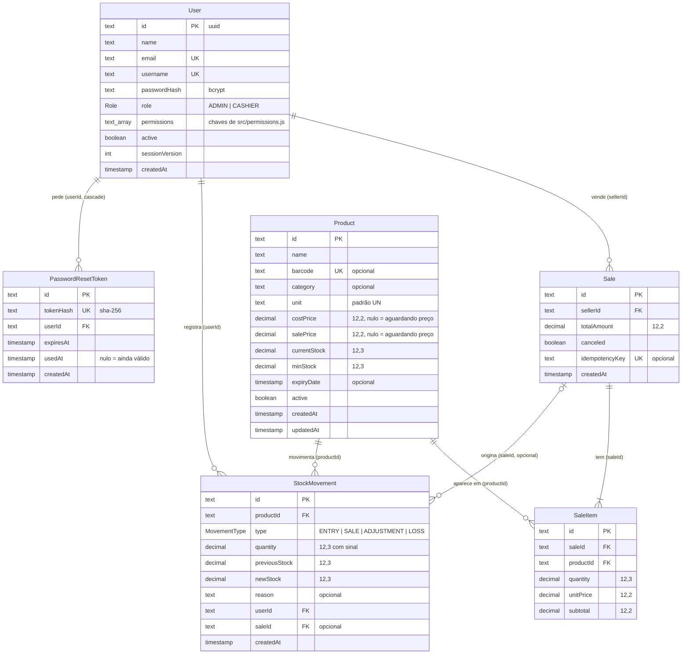

# Modelo e dicionário de dados

Fonte da verdade: [`prisma/schema.prisma`](../../prisma/schema.prisma). Migrations em `prisma/migrations/`. Banco: PostgreSQL 16, schema `public`.

## Diagrama entidade-relacionamento

## Dicionário

Todos os `id` são UUID gerados pelo Prisma e guardados como `text`. Datas são `timestamp(3)` sem fuso, gravadas em UTC.

### User

| Coluna | Tipo | Regra |
|---|---|---|
| `id` | text, PK | UUID |
| `name` | text | 1 a 120 caracteres |
| `email` | text, único | sempre em minúsculas; não editável depois de criado |
| `username` | text, único | primeiro nome sem acento + 4 dígitos (ou 6), minúsculo; gerado por `src/username.js` |
| `passwordHash` | text | bcrypt, custo 12. Senha nunca é guardada |
| `role` | enum `Role` | `ADMIN` ou `CASHIER` (padrão). Só o seed cria `ADMIN` |
| `permissions` | text[], padrão vazio | chaves de `src/permissions.js` (`sales.viewAll`, `sales.cancel`, `reports.view`, `prices.manage`, `products.manage`, `stock.manage`). Ignorada para `ADMIN`, que tem todas. Lida a cada requisição ([ADR-0014](adr/0014-permissoes-por-pessoa.md)) |
| `active` | boolean | `false` bloqueia login e derruba sessões |
| `sessionVersion` | int | sobe a cada troca de senha; comparado com o `sv` do JWT |
| `createdAt` | timestamp | |

### PasswordResetToken

| Coluna | Tipo | Regra |
|---|---|---|
| `tokenHash` | text, único | SHA-256 do token enviado por e-mail. O token em si nunca é gravado |
| `userId` | FK → User, `ON DELETE CASCADE` | |
| `expiresAt` | timestamp | criação + `PASSWORD_RESET_EXPIRES_MIN` (30) |
| `usedAt` | timestamp, nulo | preenchido ao usar ou ao pedir outro token |

Índices: `userId`, `expiresAt`. Tokens velhos não são apagados por nenhuma rotina.

### Product

| Coluna | Tipo | Regra |
|---|---|---|
| `name` | text | 1 a 150 caracteres; indexado |
| `barcode` | text, único, nulo | até 64 caracteres |
| `category` | text, nulo | até 80 caracteres, texto livre |
| `unit` | text | até 10 caracteres, padrão `UN` |
| `costPrice` | decimal(12,2), nulo | ≥ 0, até 1.000.000. Nulo = aguardando preço ([ADR-0016](adr/0016-produto-aguardando-preco.md)) |
| `salePrice` | decimal(12,2), nulo | > 0, até 1.000.000. Nulo = aguardando preço; produto assim não é vendido |
| `currentStock` | decimal(12,3) | entre 0 e 50.000.000; só muda por movimentação |
| `minStock` | decimal(12,3) | ≥ 0 |
| `expiryDate` | timestamp, nulo | gravado como meia-noite UTC do dia; a tela e o e-mail o leem sempre em UTC (`formatDateOnly`), senão Brasília mostraria o dia anterior |
| `active` | boolean | exclusão lógica ([ADR-0006](adr/0006-exclusao-logica-de-produto.md)); indexado |
| `updatedAt` | timestamp | atualizado pelo Prisma |

### Sale

| Coluna | Tipo | Regra |
|---|---|---|
| `sellerId` | FK → User, `RESTRICT` | quem estava logado |
| `totalAmount` | decimal(12,2) | soma dos subtotais, até 5.000.000 |
| `canceled` | boolean | `true` tira a venda de todos os totais |
| `idempotencyKey` | text, único, nulo | valor do cabeçalho `Idempotency-Key` da confirmação; repetir a chave devolve esta venda ([ADR-0015](adr/0015-venda-idempotente.md)). Vendas antigas e clientes que não mandam a chave ficam com nulo |
| `createdAt` | timestamp | indexado |

### SaleItem

| Coluna | Tipo | Regra |
|---|---|---|
| `saleId` | FK → Sale, `RESTRICT` | |
| `productId` | FK → Product, `RESTRICT` | |
| `quantity` | decimal(12,3) | > 0, até 10.000 |
| `unitPrice` | decimal(12,2) | preço de venda **no momento** da venda (congelado) |
| `subtotal` | decimal(12,2) | `unitPrice × quantity` |

### StockMovement

| Coluna | Tipo | Regra |
|---|---|---|
| `type` | enum `MovementType` | `ENTRY`, `SALE`, `ADJUSTMENT`, `LOSS` |
| `quantity` | decimal(12,3) | com sinal: positivo soma, negativo subtrai |
| `previousStock`, `newStock` | decimal(12,3) | saldo antes e depois, lidos na mesma transação |
| `reason` | text, nulo | até 255 caracteres |
| `userId` | FK → User, `RESTRICT` | quem fez |
| `saleId` | FK → Sale, `ON DELETE SET NULL`, nulo | preenchido na venda e no cancelamento |

Índices: `(productId, createdAt)` e `(type, createdAt)`. Nenhuma rota altera ou apaga uma linha desta tabela.

## Origem e linhagem dos dados

| Dado | Quem cria | Por onde |
|---|---|---|
| Admin | `npm run seed` | variáveis `ADMIN_NAME`, `ADMIN_EMAIL`, `ADMIN_PASSWORD` |
| Pessoa da equipe e suas permissões | dono (tela Usuários) ou a própria pessoa ("Criar conta", sem permissões e com `active = false` até o dono ligar) | `POST /api/users`, `PUT /api/users/:id`, `POST /api/auth/register` |
| Produto | quem tem `products.manage` (sem preço) ou `prices.manage` (tela Produtos ou Importar) | `POST /api/products`, `POST /api/imports/products/commit` |
| Preço de um produto aguardando preço | quem tem `prices.manage` | `PUT /api/products/:id` |
| Venda e itens | qualquer pessoa logada | `POST /api/sales` |
| Movimentação `SALE` | a venda | mesma transação de `POST /api/sales` |
| Movimentação `ENTRY` | entrada de estoque, estoque inicial, importação somando | `POST /api/stock/entries`, `POST /api/products`, importação |
| Movimentação `LOSS` | quem tem `stock.manage` | `POST /api/stock/adjustments` com `type: LOSS` |
| Movimentação `ADJUSTMENT` | cancelamento, importação substituindo saldo, ajuste pela API | `POST /api/sales/:id/cancel`, importação, `POST /api/stock/adjustments` |
| Token de nova senha | "Esqueci minha senha" | `POST /api/auth/forgot-password` |

### Dados derivados (não gravados)

| Dado | Calculado de | Onde |
|---|---|---|
| Margem | `salePrice − costPrice` (nula se aguardando preço) | `src/routes/products.js` |
| Aguardando preço (`pricePending`) | `salePrice` ou `costPrice` nulo | `src/routes/products.js`, `src/routes/dashboard.js` |
| Permissões efetivas | `role` e `permissions` | `src/permissions.js` (`effectivePermissions`) |
| Previsão de esgotamento | `StockMovement` `SALE` dos últimos 30 dias + `Product.currentStock` | `src/forecast.js` |
| Produtos parados, capital parado | `StockMovement` `SALE` dos últimos N dias + `Product` | `src/forecast.js` |
| Vendas hoje / mês, resumo por dia, mais vendidos | `Sale` e `SaleItem` não cancelados | `src/routes/dashboard.js`, `src/routes/reports.js` |

### Dados de exemplo

| Script | O que grava |
|---|---|
| `npm run seed:products` | 24 produtos de mercadinho com validades relativas a hoje e estoque inicial (movimentação `ENTRY` "Estoque inicial (carga de exemplo)"). Rodar de novo atualiza preço, categoria e validade dos 24 pelo código de barras e **reativa** os que estiverem inativos |
| `npm run simulate:sales` | vendas dos últimos 14 dias (`SIMULATE_DAYS`), direto no banco, com datas no passado. Se não houver caixa ativo, cria a conta de demonstração "Maria Caixa" com uma **senha fixa que está no código**: nunca rode em produção |
| `npm run simulate:history` | 2 anos (`SIMULATE_YEARS`) de vendas, compras e perdas que terminam exatamente no estoque atual de cada produto, substituindo a entrada de carga inicial; vendas reais ficam intactas. Recusa produção |
| `npm run seed:perfis` | três contas de teste, uma de cada tipo (Financeiro, Estoque, Caixa), com senha fixa no código. Rodar de novo restaura senha e permissões. Recusa rodar com `NODE_ENV=production` |

## Histórico de migrations

| Migration | O que faz |
|---|---|
| `20260827005750_init` | Cria `User`, `Product`, `Sale`, `SaleItem`, `StockMovement`, os enums e os índices |
| `20261002000000_add_session_version_and_password_reset` | Adiciona `User.sessionVersion` e cria `PasswordResetToken` |
| `20261014000000_add_user_username` | Adiciona `User.username`, preenche as contas existentes com a mesma regra de `src/username.js` (em PL/pgSQL), depois torna a coluna obrigatória e única |
| `20261030000000_add_sale_idempotency_key` | Adiciona `Sale.idempotencyKey` (nulo) com índice único |
| `20261106000000_add_user_permissions_and_pending_price` | Adiciona `User.permissions` (`text[]`, padrão vazio: contas existentes seguem só vendendo) e torna `Product.costPrice` e `Product.salePrice` opcionais |

Como criar e aplicar migrations: [guia de desenvolvimento](guia-de-desenvolvimento.md#mudar-o-banco) e [guias de migração](../evoluir/guias-de-migracao.md).

## Dados pessoais

O sistema guarda dados pessoais só dos **usuários**: nome, e-mail e o hash da senha. Não guarda dados de clientes do mercadinho. Tratamento e LGPD em [segurança](../sustentar/seguranca-e-base-de-conhecimento.md#lgpd).
