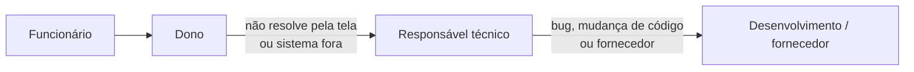

# Matriz de suporte e SLA

Quem atende o quê, quando escalar e em quanto tempo. **Não há contrato de suporte assinado.** Os níveis e prazos abaixo são uma **proposta** para combinar com o cliente; os contatos ficam a preencher.

## Níveis de suporte

| Nível | Quem | Resolve | Exemplos |
|---|---|---|---|
| **N1** | Dono do mercadinho (administrador do sistema), com apoio do financeiro para vendas e preços | Dúvidas de uso e o que a tela permite | Senha e permissões da equipe (só o dono), conta desligada, produto inativo ou aguardando preço, venda errada nas recentes, acerto de estoque. Consulta: [manual](../usar/manual-do-usuario.md) e [FAQ](../usar/faq.md) |
| **N2** | Responsável técnico pelo sistema (hoje, o desenvolvedor) | Operação: ambiente, configuração, dados | Sistema fora do ar, e-mail não chega, senha do dono, venda antiga a cancelar, restore de backup. Consulta: [runbooks](runbooks.md) |
| **N3** | Desenvolvimento (hoje, o mesmo desenvolvedor) e fornecedores | Bug no código, mudança, falha de fornecedor | Erro 500 que se repete, estoque que o histórico não explica, provedor de nuvem ou de banco fora |

Fornecedores no N3: provedor da aplicação (Render ou Railway), provedor do banco (Neon ou Supabase), provedor de e-mail (Gmail). Cada um tem a própria página de status.

## Contatos

Preencher na entrega. Não registre senhas aqui.

| Papel | Nome | Canal | Horário |
|---|---|---|---|
| N1: dono | *a preencher* | | horário da loja |
| N2: responsável técnico | *a preencher* | | *a combinar* |
| N3: desenvolvimento | *a preencher* | | *a combinar* |
| Provedor da aplicação | | painel e status do provedor | 24×7 (do provedor) |
| Provedor do banco | | painel e status do provedor | 24×7 (do provedor) |

## Severidade e prazos propostos

| Severidade | Definição | Primeira resposta | Contorno | Exemplo |
|---|---|---|---|---|
| **S1 Crítica** | Não dá para vender | 1 hora no horário da loja | 4 horas | Sistema fora do ar, login falhando para todos |
| **S2 Alta** | Função importante parada, vender ainda funciona | 4 horas úteis | 1 dia útil | Estoque, relatórios ou importação com erro; e-mail de senha fora |
| **S3 Média** | Incômodo com contorno | 1 dia útil | 5 dias úteis | Venda antiga para cancelar, alerta diário não chega |
| **S4 Baixa** | Dúvida ou melhoria | 2 dias úteis | entra no roadmap | Busca sem acento, novo relatório |

**Plano de contingência para S1:** anotar as vendas em papel (produto, quantidade, hora) e lançar quando o sistema voltar. O estoque se ajusta com as vendas lançadas depois.

## Escalonamento

Ao escalar, informe: o que estava fazendo, a hora, a mensagem exata da tela e, se possível, um print. Nunca mande senha por mensagem.

## Disponibilidade

Não há meta medida, porque não há monitoramento ([monitoramento](monitoramento.md)). Proposta para quando houver: 99% no horário de funcionamento da loja, medido pela checagem externa.

A disponibilidade em planos gratuitos de nuvem depende do provedor: alguns suspendem o serviço ou o banco depois de um período sem uso, e a primeira requisição seguinte demora. Confirmar no plano escolhido.
